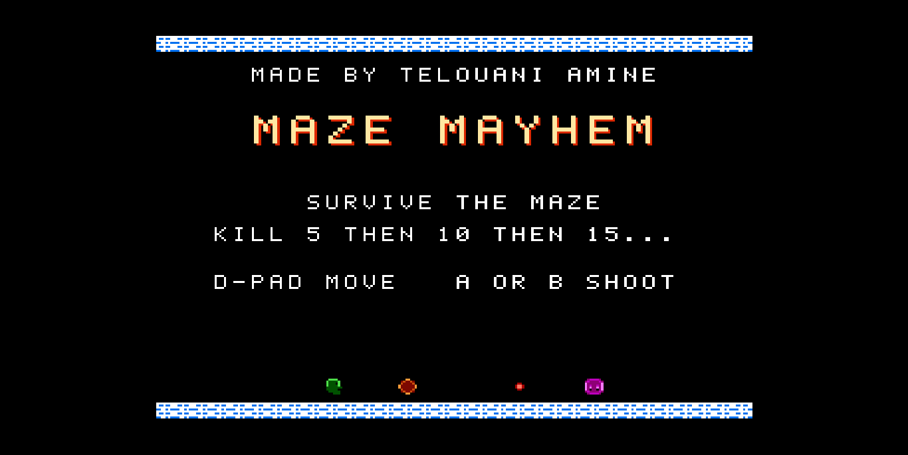

# Maze Mayhem

Maze Mayhem is an NES game written in 6502 assembly with ca65/ld65.



## Contents

- `src\maze_mayhem.asm` - Main game source
- `src\music\` - FamiTone driver and generated NES music data
- `config\nes.cfg` - ld65 linker configuration
- `build.bat` - Windows build script
- `build\maze_mayhem.nes` - Built NES ROM

## Building

Install the [cc65](https://cc65.github.io/) toolchain in `C:\cc65`, then run:

```bat
build.bat
```

The ROM is generated at `build\maze_mayhem.nes`.

## Running

Open `build\maze_mayhem.nes` with an NES emulator that supports mapper 0/NROM.

## Controls

- D-pad: Move
- A or B: Shoot
- Start: Pause or begin the game
